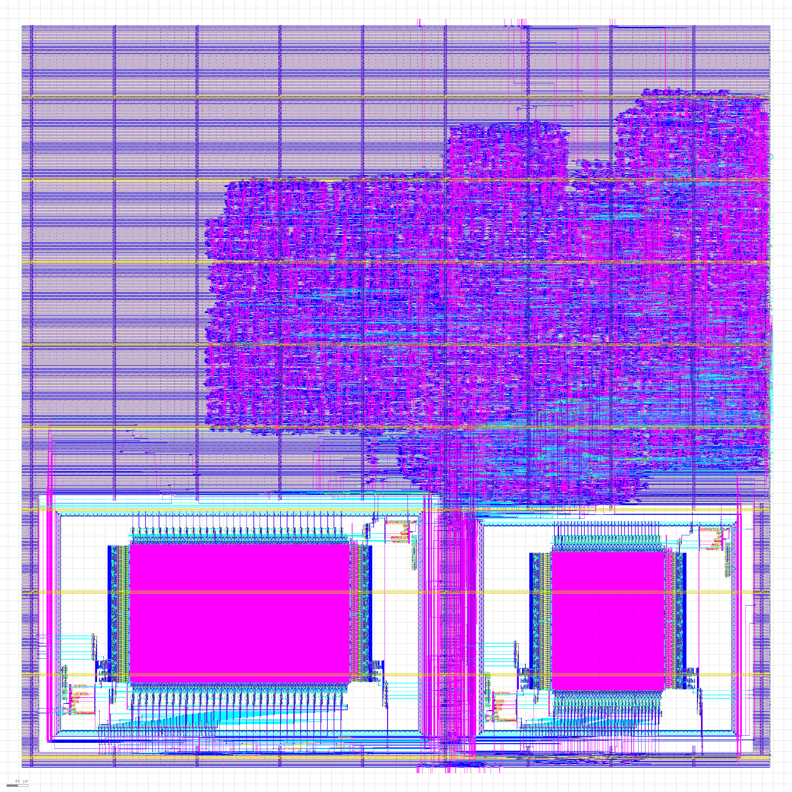
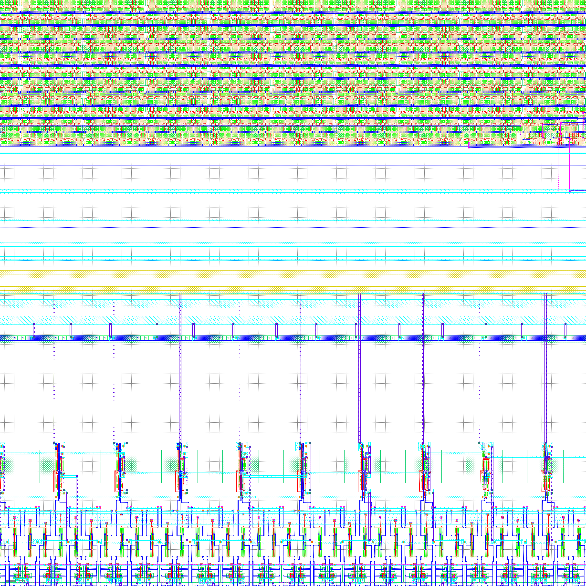

# MINERVA

A RISC-V SoC built in phases on a ZedBoard, then taken to GDS on Sky130.

Each phase was verified on hardware before the next one started. The design is a
5-stage RV32I pipeline with an L1 cache, a DMA engine, an AXI4-Lite crossbar and
a fault-injection master. P5 measured how single-bit upsets propagate through it
and hardened the RTL into a layout; P6 replaced the flop-array memories with real
SRAM macros and closed the result at 45 MHz.

---

## Current state

|                    |                                                                                                   |
| ------------------ | ------------------------------------------------------------------------------------------------- |
| **FPGA**     | ZedBoard (Zynq-7020), 100 MHz, hardware-verified through P4                                       |
| **ASIC**     | Sky130 HD, 45 MHz timing-clean across all nine PVT corners                                        |
|                    | 1.96 mm², 69,978 standard cells, 3 kB SRAM macros, 25.5 mW                                       |
|                    | DRC 0 (Magic and KLayout), LVS 0, antenna 0                                                       |
|                    | Post-route netlist proven to execute the test workload                                            |
| **Campaign** | 1,312 single-bit injections, matching an independent reference model on all 1,256 classified runs |

---

## Phases

| Phase            | What it built                                                                    | Status            | Repo                                                                       |
| ---------------- | -------------------------------------------------------------------------------- | ----------------- | -------------------------------------------------------------------------- |
| **P1**     | Heterogeneous CDC FIFO arbiter                                                   | Hardware-verified | [hetrogeneousCDCArbitrer](https://github.com/Jehka/hetrogeneousCDCArbitrer) |
| **P2**     | 5-stage RV32I pipeline, hazards and forwarding                                   | Hardware-verified | [RISCV](https://github.com/Jehka/RISCV)                                     |
| **P3–P4** | L1 cache, DMA, AXI4-Lite crossbar, AXI instruction fetch, fault-injection master | Hardware-verified | [P4_RISCV](https://github.com/Jehka/P4_RISCV)                               |
| **P5**     | Fault-injection campaigns, RTL→GDS on Sky130                                    | Complete          | this repo —[writeup](docs/P5.md)                                           |
| **P6**     | SRAM macro integration, floorplan and frequency close                            | Complete          | this repo —[writeup](docs/P6.md)                                           |

---

## P5 highlights

**The campaign.** An exhaustive single-bit sweep over every instruction and data
word of a running program: 49% silent data corruption, 30% hang or no result,
21% masked. Vulnerability by bit position tracks the RISC-V encoding — the
opcode field is the most destructive, bit 31 (immediate sign) is the single worst
bit, funct3 the most benign.

**The reference model.** An RV32I interpreter plus a model of this SoC's cache
and address map predicts the outcome of all 1,312 injections. Hardware and model
agree on 1,256 of 1,256 classified runs. Every disagreement found along the way
was a bug — three in the model, one in the test harness.

**Two bugs in a design that had passed bring-up.** A reset-domain split that
deadlocked the AXI fabric roughly 1 run in 6, invisible when the CPU is reset
once and fatal when it is reset 1,312 times. And a harness state leak that made
four classifications order-dependent.

**What the FPGA hid.** A 32-bit magnitude compare in the DMA that Vivado maps to
carry logic for free and Yosys expands into a 15-level ripple chain — the
critical path of the entire hardened design. Replaced with a reduction, with
equivalence proved by SAT miter rather than assumed.

Full detail: [docs/P5.md](docs/P5.md)

---

## P6 highlights

**8.4 million DRC errors that did not exist.** Magic reported them; KLayout,
running the PDK's signoff deck over the same GDS, reported zero. The cause is a
gap in Magic's sky130A deck, which carries no rules for the SRAM macros —
geometry it has no rules for generates spurious violations rather than being
skipped. Confirmed three ways: KLayout reads the full GDS with no abstraction and
finds nothing, Magic also reports zero once the macros are abstracted, and
hardening the macros alone reproduces the error class in isolation.

**Three timing failures, all caused by my own constraints.** `set_max_transition`
was 0.75 ns against a library limit of 1.5 — chasing it made the resizer stuff
long nets with series buffers, and each one added delay. Setting it to the
library's own value moved setup slack from −0.718 ns to +10.17 ns: a 10.9 ns
swing from *relaxing* a constraint. `set_max_fanout 10` had no library
counterpart at all, manufacturing 2,398 violations against a limit no cell has.
And a single `set_clock_uncertainty` charged the full setup jitter budget to hold
checks, which was the entire cause of the last remaining violation.

**A floorplan that made the design smaller.** The die was hard-coded at 1600 µm
and never revisited after SRAM macros deleted most of the standard cell content,
leaving 21.8% utilisation. Shrinking it to 1400 µm did not just pack the same
netlist tighter — it produced a *smaller netlist*, 11,509 fewer cells, because
shorter wires needed fewer buffers. Setup and hold both improved at the same
time.

**45 MHz for nothing.** With 10.7 ns of slack on a 31 ns clock, the critical path
was taking 20.3 ns. Rebuilt at 22 ns, the post-route netlist came back
byte-identical — same cells, same wirelength, same hold slack, setup lower by
exactly the clock delta, power up by exactly the frequency ratio. The design was
always capable of 45 MHz; the slower number was an artefact of the slew
constraint above.

**Two all-X writes, chased to the end.** Gate-level simulation logged stores of
undefined data just past the checked results. Identical across two netlists
differing by 11,509 cells, which ruled out synthesis. They turned out to be cache
line writebacks: the output region spans two and a half 16-byte lines, and the
padding words of the third were never initialised. Clearing them proved the cache
fetches on a write miss and writes back faithfully — no bug, and the test was
worth running rather than assuming.

Full detail: [docs/P6.md](docs/P6.md)

---

## Layout

The hardened die, 1400 × 1400 µm. The two SRAM macros sit along the bottom with
their pin rows facing the standard cell field above.



Where a macro meets the logic — the pin row, the keepout halo, and the abutting
standard cell rows.



---

## Repository layout

```
rtl/          core, memory, interconnect, and the ASIC top
sim/          testbenches, including the gate-level one
sw/           bring-up and campaign software, reference model
asic/         LibreLane config, SDC, results
scripts/      build and simulation runners
docs/         phase writeups
```

## Reproducing

```bash
sv2v -DSYNTHESIS -DUSE_SRAM_MACROS \
     --write=build/asic_sv2v/minerva.v -Irtl/common <rtl files>
librelane asic/config_sram.json          # harden the SRAM build
./scripts/gate_sim.sh                    # prove the netlist executes code
```

`asic/config.json` still builds the P5 flop-memory variant; omit
`-DUSE_SRAM_MACROS` for it. Layout images come from
`scripts/gds_shots.py` — see [docs/P6.md](docs/P6.md) for the invocation, which
needs the PDK's KLayout layer-properties file to render in colour.

Tools: Vivado/Vitis 2025.2 for the FPGA side; sv2v, LibreLane (Yosys, OpenROAD,
Magic, KLayout, OpenSTA), Icarus and Verilator for the ASIC side.

## Status

MINERVA is complete at P6 and no further development is planned. The core remains
available for reuse — a hardened RV32I with real SRAM macros and a signed-off
Sky130 implementation at 45 MHz.

Known limitations are documented rather than hidden: the PDK characterises the
SRAM macros only at the typical corner, 7,279 transition-time warnings remain
against real library limits as a deliberate trade against setup slack, and IR
drop is uncharacterised. See [docs/P6.md](docs/P6.md).

## License

Apache 2.0 — see [LICENSE](LICENSE).
